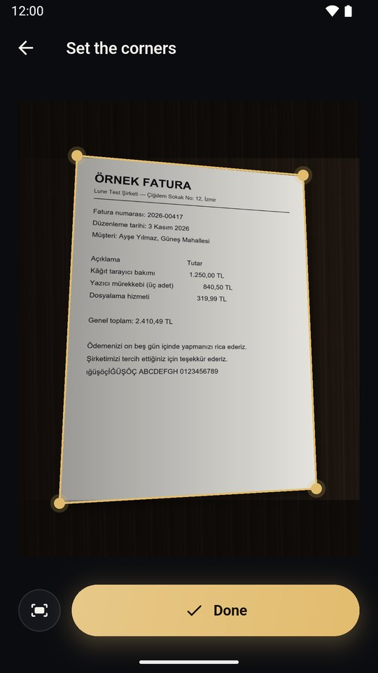
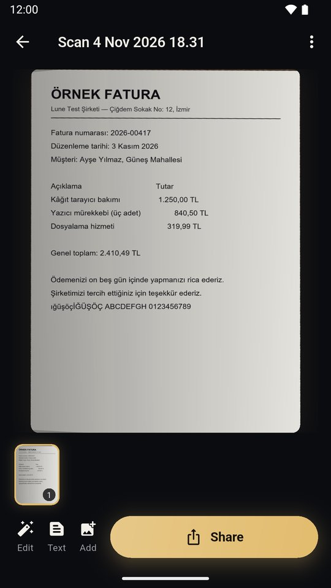
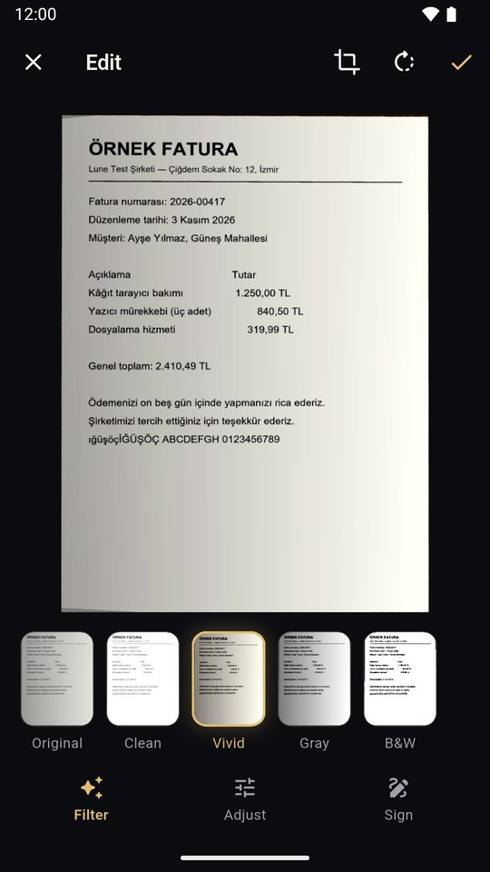
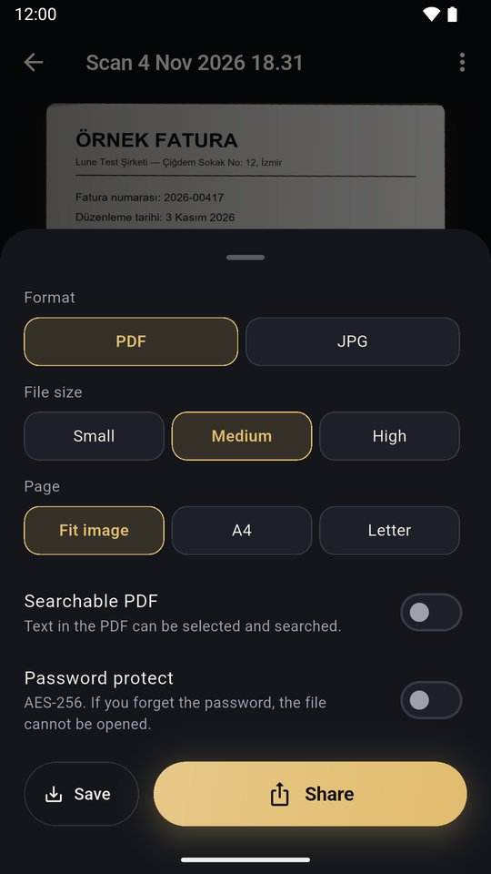
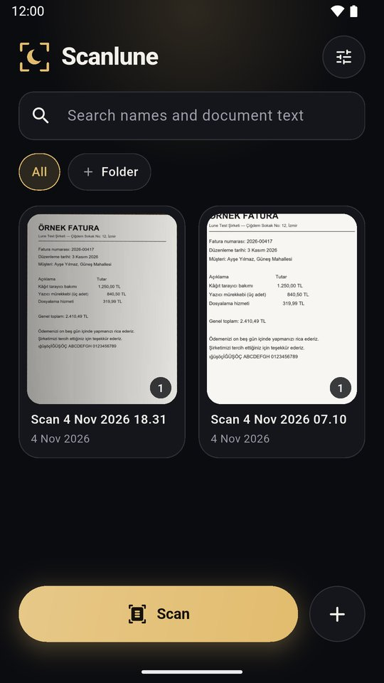

# Scanlune: PDF & QR Scanner

A private document and QR code scanner for Android. Scan a page, tidy it and share it as a PDF, or read a QR code and see what it holds before you act on it. Your scans and codes stay on your device.

[Türkçe](#türkçe) · [Privacy policy](privacy.md)

  
  
  
  
  

Set the corners · Corrected page · Filters · PDF options · Library

## Download

- **Android:** coming to Google Play.

## Features

- Automatic edge detection and perspective correction, multi-page documents, or import from your gallery.
- Crop and rotate pages by hand.
- Filters: Original, Clean, Vivid, Gray and B&W, with brightness and contrast controls.
- Read the text on a page and copy it.
- A private library with folders and search, including the text inside your documents.
- Export as PDF or JPG in the size you need. Share through any app, or save to your device.
- Read QR codes and barcodes with the camera or from a picture; open links, join Wi-Fi, add contacts and calendar events.
- Warnings for suspicious links before they open; payment codes are shown, never paid.
- Create QR codes for links, Wi-Fi, contacts and more. A code history with favorites and notes.
- No account, no cloud, no watermark and no ads. Dark themes in several accent colors, English and Turkish.

Scanning, QR codes and PDFs are free and unlimited. Scanlune Premium is one payment with no subscription, and adds searchable PDF, signatures, ID card mode, merging and splitting documents, PDF passwords and app lock.

## Support

luneapps.support@gmail.com

This repository holds the documentation only; the source code is not published here.

---

## Türkçe

Android için gizliliğine saygılı belge ve QR kod tarayıcı. Sayfayı tara, düzenle ve PDF olarak paylaş; QR kodu okut ve ne olduğunu görmeden hiçbir şey açma. Taramaların ve kodların cihazında kalır.

[Gizlilik politikası](privacy.md#türkçe)

Ekran görüntüleri (yukarıda): Köşeleri ayarlama · Düzeltilmiş sayfa · Filtreler · PDF seçenekleri · Kitaplık

### İndir

- **Android:** yakında Google Play'de.

### Özellikler

- Otomatik kenar algılama ve perspektif düzeltme, çok sayfalı belgeler veya galeriden içe aktarma.
- Sayfaları elle kırpma ve döndürme.
- Filtreler: Orijinal, Temiz, Canlı, Gri ve S/B; parlaklık ve kontrast ayarı.
- Sayfadaki metni okuma ve kopyalama.
- Klasörleri ve araması olan özel kitaplık; arama belgelerin içindeki metni de kapsar.
- İstediğin boyutta PDF veya JPG olarak dışa aktarma. Herhangi bir uygulamayla paylaşma veya cihaza kaydetme.
- Kamerayla veya bir görselden QR kod ve barkod okuma; bağlantı açma, Wi-Fi'ye bağlanma, rehbere ve takvime ekleme.
- Şüpheli bağlantılar açılmadan önce uyarı; ödeme kodlarını gösterir, ödeme yapmaz.
- Bağlantı, Wi-Fi, kişi ve daha fazlası için QR oluşturma. Favorileri ve notları olan kod geçmişi.
- Hesap, bulut, filigran ve reklam yok. Farklı vurgu renklerinde koyu temalar, Türkçe ve İngilizce.

Tarama, QR kod ve PDF ücretsiz ve sınırsızdır. Scanlune Premium tek ödemedir, abonelik yoktur; aranabilir PDF, imza, kimlik kartı modu, belge birleştirme ve bölme, PDF şifreleme ve uygulama kilidi ekler.

### Destek

luneapps.support@gmail.com

Bu depoda yalnızca belgeler bulunur; kaynak kod burada yayımlanmaz.
